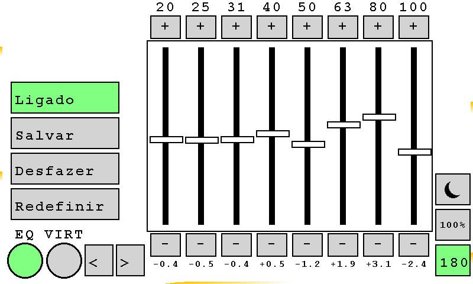
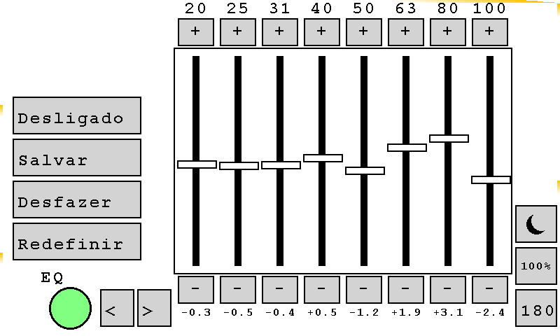
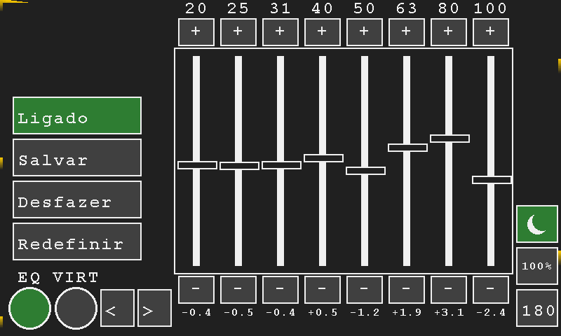
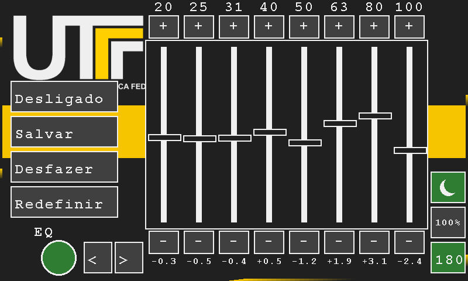
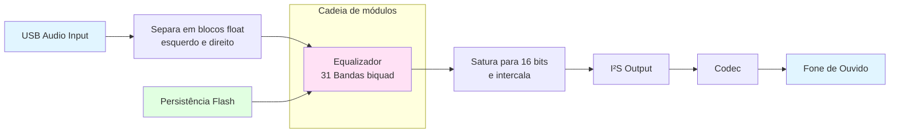

# Processador de Áudio e Otimizador de Fones de Ouvido Independente

Este projeto implementa um dispositivo autônomo capaz de processar e otimizar sinais de áudio provenientes de notebooks e celulares quando conectados a fones de ouvido. O dispositivo funciona como um dispositivo USB Audio Class, interceptando o sinal de áudio digital e aplicando processamento digital de sinais (DSP) antes da conversão analógica final.

## Descrição

O projeto visa reduzir gargalos no processo de entrega de áudio, desde o envio em formato digital pelo dispositivo transmissor até a fase final analógica entregue ao fone de ouvido. Sua principal funcionalidade está na melhoria da qualidade de som entregue a fones de ouvido de entrada e média qualidade, sem a necessidade de utilização de equipamentos de alto custo.

### Características Principais

- **Dispositivo USB Audio Class**: Funciona como dispositivo de áudio USB autônomo, sem necessidade de drivers específicos
- **Processamento Digital de Sinais**: Aplica filtros biquad para equalização personalizada
- **Interface Touchscreen**: Permite ajuste visual e interativo dos parâmetros de equalização
- **Persistência de Configurações**: Salva as configurações de equalização na memória flash
- **31 Bandas de Equalização**: Equalizador gráfico de 1/3 de oitava, com as frequências centrais da ISO 266, de 20 Hz a 20 kHz
- **Alta Qualidade**: Conversão e amplificação de alta qualidade para melhor fidelidade sonora

## Hardware

O projeto foi desenvolvido para a placa de desenvolvimento **STM32F769I-Discovery**, que possui:

- **Microcontrolador**: STM32F769NIH6 (ARM Cortex-M7, 216 MHz)
- **Display LCD**: Tela touchscreen integrada
- **Áudio**: Codec WM8994 integrado
- **USB**: Interface USB OTG FS/HS
- **Memória Flash**: Para persistência de configurações

## Estrutura do Projeto

```
.
├── Application/
│   ├── DSP/                    # Processamento Digital de Sinais
│   │   ├── Inc/
│   │   │   ├── audio_user_dsp.h
│   │   │   ├── cycle_counter.h
│   │   │   ├── dsp_module.h        # Contrato de um Módulo
│   │   │   └── equalizer.h
│   │   └── Src/
│   │       ├── audio_user_dsp.c    # Cadeia de módulos e medição de ciclos
│   │       └── equalizer.c         # Equalizador: filtros biquad de 31 Bandas
│   ├── Persistence/            # Persistência de dados
│   │   ├── Inc/
│   │   │   └── flash_persistence.h
│   │   └── Src/
│   │       └── flash_persistence.c  # Salvamento na flash
│   ├── Streaming/              # Streaming de áudio
│   │   ├── Inc/
│   │   └── Src/
│   │       └── audio_usb_playback_session.c  # Sessão de playback USB
│   ├── Touchscreen/            # Interface touchscreen
│   │   ├── Inc/
│   │   └── Src/
│   │       └── touchscreen.c   # Controle de toque e interface
│   ├── USB_Device_Audio/       # Stack USB Audio Class
│   │   ├── Inc/
│   │   └── Src/
│   └── User/                   # Código principal
│       ├── Inc/
│       └── Src/
│           └── main.c          # Função principal
├── Drivers/                    # Drivers HAL e BSP da ST
│   ├── BSP/
│   ├── CMSIS/
│   └── STM32F7xx_HAL_Driver/
└── Utilities/                  # Utilitários (fontes, etc.)
```

### Código da ST

O código em `Drivers/` é cópia sem edição dos repositórios da ST no GitHub, nas versões que o [STM32CubeF7](https://github.com/STMicroelectronics/STM32CubeF7) v1.17.4 usa. O `.gitmodules` do STM32CubeF7 lista o repositório de cada componente, e a tag de cada um sai do commit que o submódulo aponta.

| Componente | Pasta | Versão | Origem |
| --- | --- | --- | --- |
| HAL | `Drivers/STM32F7xx_HAL_Driver` | v1.3.3 | [stm32f7xx-hal-driver](https://github.com/STMicroelectronics/stm32f7xx-hal-driver) |
| CMSIS Device | `Drivers/CMSIS/Device/ST/STM32F7xx` | v1.2.10 | [cmsis-device-f7](https://github.com/STMicroelectronics/cmsis-device-f7) |
| CMSIS Core | `Drivers/CMSIS/Include` | 5.0.8 | Pasta `Drivers/CMSIS/Include` do [STM32CubeF7](https://github.com/STMicroelectronics/STM32CubeF7) v1.17.4 |
| BSP da placa | `Drivers/BSP/STM32F769I-Discovery` | v2.2.1 | [32f769idiscovery-bsp](https://github.com/STMicroelectronics/32f769idiscovery-bsp) |
| Painel OTM8009A | `Drivers/BSP/Components/otm8009a` | v1.0.7 | [stm32-otm8009a](https://github.com/STMicroelectronics/stm32-otm8009a) |
| Painel NT35510 | `Drivers/BSP/Components/nt35510` | v1.0.3 | [stm32-nt35510](https://github.com/STMicroelectronics/stm32-nt35510) |
| Touch FT6x06 | `Drivers/BSP/Components/ft6x06` | v1.0.2 | [stm32-ft6x06](https://github.com/STMicroelectronics/stm32-ft6x06) |
| Ponte HDMI ADV7533 | `Drivers/BSP/Components/adv7533` | v1.0.2 | [stm32-adv7533](https://github.com/STMicroelectronics/stm32-adv7533) |
| Interfaces comuns | `Drivers/BSP/Components/common` | v4.0.1 | [stm32-bsp-common](https://github.com/STMicroelectronics/stm32-bsp-common) |

Do HAL, o projeto guarda todos os headers e só os `.c` que o `cmake/files.cmake` compila.

O código de áudio USB vem do pacote [X-CUBE-USB-AUDIO](https://www.st.com/en/embedded-software/x-cube-usb-audio.html) 1.0.0, a única versão publicada. A ST distribui esse pacote só pelo site, sem repositório no GitHub. Ele foi adaptado ao projeto, então não é cópia fiel:

- `Application/USB_Device_Audio/` e `Application/Streaming/`
- `Drivers/BSP/STM32F769I-Discovery/stm32f769i_discovery_audio_ex.*` e `Drivers/BSP/Components/wm8994/`

#### Atualizar o código da ST

O script `tools/check_vendor.py` compara esta tabela com as versões que a última release do STM32CubeF7 usa. Ele termina com código 1 quando há atualização:

```bash
tools/check_vendor.py
```

O script não compara com a tag mais nova de cada repositório, porque algumas são de outra API. O `stm32-otm8009a`, por exemplo, já tem a v2.0.2, mas o STM32CubeF7 continua na v1.0.7. Atualize sempre para as versões de uma mesma release do STM32CubeF7, que a ST testou juntas.

Para avisos de release novo, use **Watch → Custom → Releases** no [STM32CubeF7](https://github.com/STMicroelectronics/STM32CubeF7).

Para atualizar:

1. Copie os arquivos da nova tag de cada componente por cima dos atuais.
2. Leia no `Release_Notes.html` de cada componente as mudanças desde a versão anterior, principalmente as dos módulos que o projeto usa: PCD/USB, SAI, I2C, DSI, LTDC e FLASH.
3. Compile e rode `tools/usb_audio_probe.py` na placa.
4. Atualize as versões nesta tabela.

O teste na placa é obrigatório. O HAL v1.3.0, por exemplo, mudou o que o driver faz antes de chamar o `HAL_PCD_ISOOUTIncompleteCallback`. O código compilou sem aviso, mas o áudio parou até o `usbd_audio.c` ser corrigido.

## Funcionalidades Técnicas

### Processamento de Áudio

O sistema implementa:

- **Filtros Biquad**: Filtros IIR (Infinite Impulse Response) de segunda ordem para equalização
- **31 Bandas de Frequência**: Equalizador gráfico de 1/3 de oitava, de 20 Hz a 20 kHz
- **Processamento em Tempo Real**: Processamento de amostras de áudio em tempo real via USB
- **Formato PCM**: Suporte a áudio PCM estéreo (2 canais)

### Interface de Usuário

- **Touchscreen**: Interface gráfica para ajuste de equalização
- **Sliders Visuais**: Controles deslizantes para cada banda de frequência, 8 por página
- **Feedback Visual**: Exibição das configurações atuais no display LCD

### Persistência

- **Armazenamento em Flash**: Configurações de equalização são salvas no setor 12 da flash, o primeiro setor do banco 2 (16 KB, endereço `0x08100000`). A flash fica em modo dual-bank. Assim, apagar esse setor não trava o código que roda do banco 1, e o áudio USB continua durante a gravação
- **Restauração Automática**: Configurações são restauradas automaticamente na inicialização
- **Marca de Formato**: A primeira palavra do setor guarda a marca `EQ31`. Os ajustes de 8 bandas salvos por versões antigas do firmware não têm essa marca e são descartados: todas as bandas começam em 0 dB
- **Palavras do Setor**: depois da marca vêm os 31 ganhos, a rotação, o brilho, o modo escuro e a chave do Equalizador, uma palavra cada. Um setor gravado por um firmware mais antigo tem as palavras novas apagadas (`0xFFFFFFFF`), e cada uma delas mantém o comportamento antigo: tela sem rotação, brilho máximo, tema claro e Equalizador ligado
- **Salvamento no Toque**: a rotação, o brilho, o modo escuro e a chave do Equalizador são salvos assim que tocados. Esse salvamento regrava os últimos ganhos salvos, nunca os ganhos na tela, então só o botão "Salvar" grava edições de ganho

## Como Compilar e Executar

O projeto usa CMake. Ele foi convertido do STM32CubeIDE na versão 2.0.

### Pré-requisitos

1. **Visual Studio Code** com a extensão **STM32CubeIDE for Visual Studio Code**, da STMicroelectronics.
2. No **STM32Cube Bundles Manager** da extensão, instale:
   - `gnu-tools-for-stm32` (compilador GCC, versão 14.3.1)
   - `cmake` e `ninja`
   - `programmer` (STM32CubeProgrammer)
   - `stlink-gdbserver`
3. **Placa STM32F769I-Discovery** e dois cabos USB com dados:
   - **CN16 (ST-LINK)**: grava e depura o firmware.
   - **USB OTG**: conecta a placa como dispositivo de áudio.

No Linux, instale as regras do udev do ST-LINK para usar a placa sem `root`:

```bash
sudo cp ~/.local/share/stm32cube/bundles/stlink-gdbserver/*/bin/49-stlink*.rules /etc/udev/rules.d/
sudo udevadm control --reload-rules && sudo udevadm trigger
```

### Compilar

No VS Code, abra a pasta do projeto, escolha o preset **Debug** e clique em **Build**.

Pelo terminal, com as ferramentas dos bundles no `PATH`:

```bash
cmake --preset Debug
cmake --build --preset Debug
```

O firmware fica em `build/Debug/horoscope.elf`.

### Gravar a Placa

```bash
STM32_Programmer_CLI -c port=SWD -w build/Debug/horoscope.elf -v -rst
```

A gravação apaga só os setores do programa. As configurações do equalizador, salvas no setor 12, são mantidas.

#### Configurar a flash em dual-bank (uma vez por placa)

A placa vem de fábrica com a flash em modo single-bank (`nDBANK=1`). O firmware precisa do modo dual-bank (`nDBANK=0`): em single-bank, o botão "Salvar" não grava nada. A troca de modo muda o mapa da flash e embaralha o conteúdo gravado. Por isso, apague o chip e grave o firmware de novo:

```bash
STM32_Programmer_CLI -c port=SWD mode=UR reset=HWrst -ob nDBANK=0
STM32_Programmer_CLI -c port=SWD mode=UR reset=HWrst -e all
STM32_Programmer_CLI -c port=SWD -w build/Debug/horoscope.elf -v -rst
```

Confira com `STM32_Programmer_CLI -c port=SWD -ob displ`. A linha `nDBANK` deve mostrar `0x0`. Os ajustes do equalizador salvos antes da troca são perdidos: todas as bandas começam em 0 dB.

### Capturar a Tela do LCD

O script `tools/lcd_capture.py` lê a imagem do LCD pelo ST-LINK e salva um PNG. O firmware continua funcionando durante a leitura, que leva cerca de 10 segundos. Ele precisa do Python com a biblioteca Pillow.

```bash
tools/lcd_capture.py lcd.png
```

### Testar o Áudio USB na Placa

O script `tools/usb_audio_probe.py` grava o firmware e toca um tom baixo de 440 Hz no dispositivo de áudio da placa. Enquanto o tom toca, ele lê pelo ST-LINK o estado da sessão de playback e do nó do alto-falante. O teste passa quando os dois estão em `STARTED`. Ele precisa dos dois cabos USB (ST-LINK e USB OTG) e das bibliotecas sounddevice e numpy:

```bash
pip install sounddevice numpy
```

```bash
tools/usb_audio_probe.py
```

Sem argumento, ele usa o `build/Debug/horoscope.elf`. A linha `idle` mostra o estado antes do tom. Ela já aparece como `STARTED` se outro programa estiver tocando áudio na placa.

As linhas abaixo de `dsp worst case` mostram quanto do orçamento de 1 ms por pacote o DSP consome: uma linha por Módulo, na ordem da Cadeia, e uma linha para a Cadeia inteira. O firmware mede com o contador de ciclos DWT do Cortex-M7 cada Módulo e cada chamada de `AudioUserDsp_Process`, e guarda o maior valor desde a inicialização nas variáveis globais `moduleWorstCaseCycles` (uma posição por Módulo) e `chainWorstCaseCycles`. A Cadeia inclui também a conversão do pacote para `float` e a saturação de volta para 16 bits. A sonda lê essas variáveis pelo ST-LINK, pelo símbolo do ELF, e mostra os ciclos e a porcentagem do orçamento de 216.000 ciclos (1 ms a 216 MHz). Os nomes dos Módulos ficam na lista `MODULES` da sonda; se a Cadeia do firmware tiver outro tamanho, a sonda para e pede que a lista seja atualizada. O valor inclui as interrupções que preemptam o DSP e a recompilação de uma Banda por pacote depois de uma mudança de ganho. A medição só tem sentido depois de o tom tocar por alguns segundos.

### Testar o DSP no PC

O script `tools/dsp_test.py` confere a resposta do equalizador sem a placa. Ele compila as fontes de `Application/DSP/` como biblioteca compartilhada com o compilador C do pacote `ziglang`, passa sinais de teste pela mesma função que o callback USB chama, pacote a pacote, e mede a saída com o numpy. Os ganhos e a chave do Equalizador são ajustados pelos mesmos `eqGains` e `eqEnabled` que a tela altera. O DSP lê o contador de ciclos DWT por `cycle_counter.h`, que o firmware implementa em `Application/User/Src/cycle_counter.c`. No PC, o substituto em `tools/dsp_pc/` sempre lê zero. Antes de medir, os testes reinicializam o DSP e descartam um segundo de pacotes.

Instale as dependências pelo pip. As versões são fixas para que todos meçam com o mesmo compilador:

```bash
pip install ziglang==0.16.0 numpy==2.5.4
```

```bash
tools/dsp_test.py
```

Cada caso imprime `ok` ou `FAIL` com a resposta que saiu errada (banda, canal, frequência, medido e esperado). Se algum caso falhar, o script termina com código 1. Para rodar só alguns casos, passe parte do nome, como `tools/dsp_test.py cookbook`.

Com o matplotlib instalado, `--plot` salva um PNG de cada resposta medida na pasta indicada:

```bash
pip install matplotlib==3.11.2
```

```bash
tools/dsp_test.py --plot build/pc/plots
```

Os casos de hoje:

- Com todas as bandas em 0 dB, a saída é igual à entrada bit a bit.
- Com o Equalizador desligado e as bandas em ±6 dB, a saída é igual à entrada bit a bit.
- Desligar e religar o Equalizador no pico de um tom de 1 kHz com a banda de 1 kHz em +6 dB não produz um salto entre amostras maior que o do próprio sinal, ligado ou desligado. Depois de religado, a saída é igual à de uma execução que nunca desligou, o que prova que os filtros acompanharam o sinal.
- Cada banda sozinha em +6 dB mede +6 dB ± 0,1 dB na frequência central e segue a curva do Audio EQ Cookbook, também com tolerância de 0,1 dB, uma oitava para cada lado.

### Formatar e Analisar o Código

O clang-format formata o código e o clang-tidy procura erros comuns. As regras ficam em `.clang-format` e `.clang-tidy`. As bibliotecas da ST em `Drivers/` e `Utilities/` e os headers de imagem, listados em `.clang-format-ignore`, ficam de fora.

Instale as duas ferramentas pelo pip. A versão do clang-format é fixa, porque versões diferentes formatam de jeitos diferentes:

```bash
pip install clang-format==23.1.3 clang-tidy==23.1.4
```

O script `tools/lint.py` roda as ferramentas sobre o código do projeto:

```bash
tools/lint.py format
```

```bash
tools/lint.py check
```

```bash
tools/lint.py tidy
```

`format` reescreve os arquivos, `check` só aponta o que está fora do padrão e `tidy` roda o clang-tidy. O `tidy` usa o `compile_commands.json` gerado pelo CMake, então compile o preset **Debug** antes. A extensão da ST para o VS Code usa o clangd, que lê os mesmos arquivos: o comando **Format Document** segue o `.clang-format` e os avisos do `.clang-tidy` aparecem no editor.

## Como Usar

1. **Conectar o Dispositivo**:
   - Conecte a placa STM32F769I-Discovery ao computador via USB
   - O dispositivo será reconhecido como um dispositivo USB Audio Class

2. **Selecionar como Saída de Áudio**:
   - No sistema operacional (Windows/Linux/Mac), selecione o dispositivo "Horoscope" ou similar como saída de áudio padrão
   - O dispositivo aparece como um dispositivo de áudio USB

3. **Ajustar a Equalização**:
   - Toque no botão "EQ" para abrir a tela do equalizador
   - A tela mostra 8 bandas por vez, em 4 páginas: 20 Hz a 100 Hz, 125 Hz a 630 Hz, 800 Hz a 4 kHz e 5 kHz a 20 kHz
   - Use os botões "<" e ">", à direita do botão "EQ", para trocar de página. Da última página, ">" volta para a primeira
   - Arraste o slider de cada banda para ajustar o ganho, de -15 dB a +15 dB, em passos de 1 dB
   - Toque em "Salvar" para gravar os ajustes na flash, em "Desfazer" para voltar aos ajustes salvos e em "Redefinir" para voltar todas as bandas a 0 dB
   - O botão acima de "Salvar" liga e desliga o Equalizador. Verde e "Ligado", o som passa pelas Bandas; cinza e "Desligado", o som sai plano e os ganhos continuam na tela, prontos para quando ele for religado. A troca leva 1 ms e não faz clique. A escolha é salva na flash no toque

   | | Ligado | Desligado |
   |---|---|---|
   | Tema claro |  |  |
   | Tema escuro |  |  |

   As capturas com o botão "180" verde foram feitas com a tela girada. A captura lê a memória de vídeo, que é a mesma nas duas orientações, porque quem gira a imagem é o painel

4. **Conectar o Fone de Ouvido**:
   - Conecte o fone de ouvido na saída de áudio da placa
   - O áudio processado será reproduzido através do fone

## Detalhes Técnicos

### Especificações de Áudio

- **Formato**: PCM (Pulse Code Modulation)
- **Canais**: Estéreo (2 canais: esquerdo e direito)
- **Resolução**: 16 bits por amostra
- **Frequências Suportadas**: Configurável (padrão: 48 kHz)

### Filtros Biquad

O sistema utiliza filtros biquad do tipo "peaking equalizer" para cada banda de frequência. Os coeficientes são calculados usando as fórmulas do Audio EQ Cookbook:

- **Ganho**: Ajustável de -15 dB a +15 dB por banda
- **Frequência Central**: 31 frequências da ISO 266, de 20 Hz a 20 kHz, em passos de 1/3 de oitava
- **Largura de Banda**: 1/3 de oitava em todas as bandas

### Arquitetura de Processamento

O callback de USB OUT entrega cada pacote, com quadros estéreo de 16 bits intercalados, a `AudioUserDsp_Process`, que o processa no lugar. Ela separa o pacote em dois blocos `float`, esquerdo e direito, e passa os dois blocos juntos por cada Módulo da Cadeia, em ordem. Só depois do último Módulo ela satura para 16 bits e intercala de volta; nenhum Módulo satura no meio da Cadeia. A Cadeia é uma lista fixa, definida em tempo de compilação em `audio_user_dsp.c`. Hoje ela tem só o Equalizador.

Cada Módulo tem uma chave de liga e desliga, e quem a aplica é a Cadeia. Ela roda o Módulo mesmo desligado, para que o histórico dos filtros acompanhe o sinal, e então guarda ou descarta a saída. No pacote em que a chave muda, a saída passa em linha reta do sinal sem processamento para o processado, ou ao contrário, ao longo do pacote (1 ms), sem clique. Por isso o Módulo custa os mesmos ciclos ligado ou desligado.



## Referências

Este projeto foi desenvolvido como Trabalho de Conclusão de Curso (TCC) de Engenharia Eletrônica na UTFPR.

### Bibliotecas e Frameworks Utilizados

- **STM32 HAL**: Hardware Abstraction Layer da STMicroelectronics
- **USB Device Library**: Stack USB da STMicroelectronics
- **CMSIS**: Cortex Microcontroller Software Interface Standard

As versões e os repositórios de origem estão em [Código da ST](#código-da-st).

### Documentação Relacionada

- [STM32F769I-Discovery User Manual](https://www.st.com/en/evaluation-tools/stm32f769i-disco.html)
- [USB Audio Class Specification](https://www.usb.org/documents)
- [Audio EQ Cookbook](https://webaudio.github.io/Audio-EQ-Cookbook/audio-eq-cookbook.html)

## Troubleshooting

### O dispositivo não é reconhecido como áudio USB

- Verifique se o cabo USB está conectado corretamente
- Verifique se o firmware foi programado corretamente na placa
- No Linux, verifique com `lsusb` se o dispositivo aparece
- No Windows, verifique no Gerenciador de Dispositivos

### Áudio não está sendo reproduzido

- Verifique se o dispositivo foi selecionado como saída de áudio padrão
- Verifique a conexão do fone de ouvido na placa
- Verifique se há áudio sendo enviado pelo sistema operacional

## Licença

Este projeto foi desenvolvido como trabalho acadêmico. Consulte os arquivos de licença individuais dos componentes utilizados (STM32 HAL, USB Device Library, etc.).

## Autor

**Marcelo Fernandes de Morais Filho**

Trabalho de Conclusão de Curso de Graduação em Engenharia Eletrônica  
Universidade Tecnológica Federal do Paraná (UTFPR)  
Orientador: Prof. Dr. Rafael Eleodoro de Góes

---

*"Somebody was trying to tell me that CDs are better than vinyl because they don't have any surface noise. I said, 'Listen, mate, life has surface noise."* - John Peel

